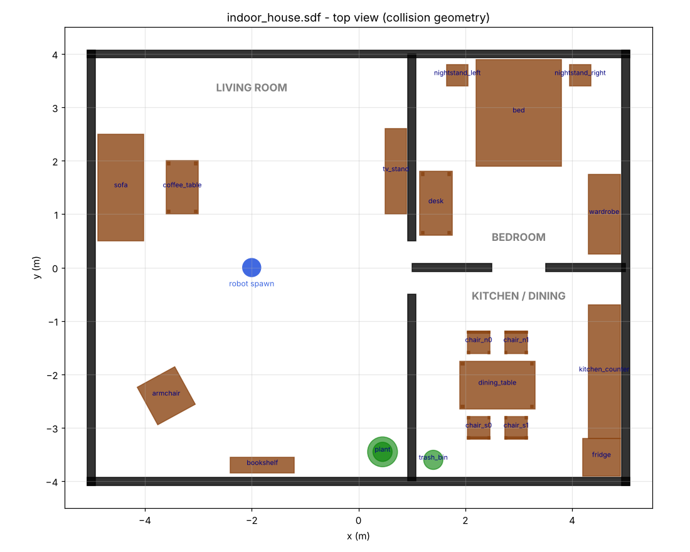

# indoor-navigation-for-a-cleaning-robot

Implement a SLAM system for a cleaning robot to navigate and map a typical household with obstacles and furniture.

A simulated, differential-drive robot vacuum explores a furnished three-room house in
**Gazebo Sim (Harmonic)** and builds a 2D occupancy map with **SLAM Toolbox**, visualised in **RViz2**,
on **ROS 2 Jazzy**. No real hardware needed.



## Packages

| Package | What it contains |
|---|---|
| `cleaning_robot_description` | URDF/xacro of the robot (34 cm round base, 2 drive wheels, 2 casters, 360° LiDAR at ~11.5 cm, IMU) and a Gazebo plugin file |
| `cleaning_robot_gazebo` | `indoor_house.sdf` world, `ros_gz_bridge` topic map, `sim.launch.py` |
| `cleaning_robot_slam` | SLAM Toolbox parameters, `slam.launch.py`, RViz config, `maps/` folder |
| `tools/` | `generate_indoor_world.py` – regenerates the world SDF from a Python layout |

```
src/
├── cleaning_robot_description/  urdf/  launch/display.launch.py  rviz/
├── cleaning_robot_gazebo/       worlds/indoor_house.sdf  config/ros_gz_bridge.yaml  launch/sim.launch.py
└── cleaning_robot_slam/         config/mapper_params_online_async.yaml  launch/slam.launch.py  rviz/  maps/
```

## Prerequisites

Ubuntu 24.04, ROS 2 Jazzy, Gazebo Sim Harmonic (`gz sim --version` → 8.x).

```bash
sudo apt update
sudo apt install -y \
  ros-jazzy-ros-gz \
  ros-jazzy-slam-toolbox \
  ros-jazzy-nav2-map-server \
  ros-jazzy-xacro \
  ros-jazzy-robot-state-publisher \
  ros-jazzy-joint-state-publisher \
  ros-jazzy-joint-state-publisher-gui \
  ros-jazzy-teleop-twist-keyboard \
  ros-jazzy-rviz2
```

## Build

```bash
git clone https://github.com/bmusunur/indoor-navigation-for-a-cleaning-robot.git
cd indoor-navigation-for-a-cleaning-robot
source /opt/ros/jazzy/setup.bash
rosdep install --from-paths src --ignore-src -y   # optional, installs anything missing
colcon build --symlink-install
source install/setup.bash
```

The repository root is the colcon workspace. Run `source install/setup.bash` in every new terminal.

## Run

### 0. (Optional) inspect the robot model

```bash
ros2 launch cleaning_robot_description display.launch.py
```

### 1. Start the simulation

```bash
ros2 launch cleaning_robot_gazebo sim.launch.py            # add rviz:=true to see scan + odom
```

Gazebo opens with the house and the robot in the living room at (-2, 0).
Check the bridge with `ros2 topic hz /scan` (≈10 Hz) and `ros2 topic hz /odom` (≈30 Hz).

### 2. Start SLAM Toolbox + RViz (terminal 2)

```bash
ros2 launch cleaning_robot_slam slam.launch.py
```

or start the simulation and SLAM together: `ros2 launch cleaning_robot_slam slam.launch.py sim:=true`.

### 3. Drive the robot around (terminal 3)

```bash
ros2 run teleop_twist_keyboard teleop_twist_keyboard
```

Drive slowly (press `z` a few times to reduce speed to ≈0.2 m/s) through all three rooms,
then come back to where you started so SLAM Toolbox can close the loop.

### 4. Save the map (terminal 4)

```bash
ros2 run nav2_map_server map_saver_cli -f src/cleaning_robot_slam/maps/indoor_house
```

This writes `indoor_house.pgm` + `indoor_house.yaml`, which AMCL / Nav2 use for localization.
To also keep the SLAM pose graph (so you can resume mapping or use SLAM Toolbox's localization
mode later), use **Serialize Map** in the SlamToolboxPlugin panel in RViz.

## TF tree

```
map ──(slam_toolbox)──> odom ──(Gazebo DiffDrive)──> base_footprint ──(robot_state_publisher)──> base_link
                                                                                                  ├── lidar_link
                                                                                                  ├── imu_link
                                                                                                  ├── left/right_wheel_link
                                                                                                  └── front/rear_caster_link
```

## Topics

| Topic | Type | Direction |
|---|---|---|
| `/cmd_vel` | `geometry_msgs/Twist` | ROS → Gazebo |
| `/odom` | `nav_msgs/Odometry` | Gazebo → ROS |
| `/tf` | `tf2_msgs/TFMessage` | Gazebo → ROS (odom → base_footprint) |
| `/joint_states` | `sensor_msgs/JointState` | Gazebo → ROS |
| `/scan` | `sensor_msgs/LaserScan` | Gazebo → ROS |
| `/imu` | `sensor_msgs/Imu` | Gazebo → ROS |
| `/clock` | `rosgraph_msgs/Clock` | Gazebo → ROS |
| `/map` | `nav_msgs/OccupancyGrid` | SLAM Toolbox |

## Changing the house

Edit the layout in `tools/generate_indoor_world.py` (walls, furniture helpers: `solid_box`, `table`,
`chair`, `plant`) and regenerate:

```bash
python3 tools/generate_indoor_world.py
colcon build --packages-select cleaning_robot_gazebo
```

## Troubleshooting

- **No `/scan` data / LiDAR not shown** – the world must load the `Sensors` system with `ogre2`
  (already in `indoor_house.sdf`). On VMs without a GPU try `export LIBGL_ALWAYS_SOFTWARE=1`.
- **Map does not appear in RViz** – check `ros2 run tf2_tools view_frames` shows `map → odom → base_footprint`,
  and that every node uses sim time (`use_sim_time: true`, already set in the launch files).
- **Robot does not move** – `ros2 topic echo /cmd_vel` while pressing teleop keys; `gz topic -e -t /cmd_vel`
  should show the same commands on the Gazebo side.
- **Smeared / doubled walls in the map** – drive slower and turn slower; fast rotations are the
  usual cause of scan-matching errors.

## Roadmap

- [x] Indoor house world in Gazebo Harmonic
- [x] Differential-drive cleaning robot with LiDAR + IMU
- [x] Mapping with SLAM Toolbox
- [ ] Localization on the saved map: AMCL vs SLAM Toolbox localization mode (accuracy vs Gazebo ground truth, kidnapped-robot test)
- [ ] `robot_localization` EKF fusing wheel odometry + IMU
- [ ] Nav2 point-to-point navigation
- [ ] Coverage (cleaning-path) planning over the free space of the map
